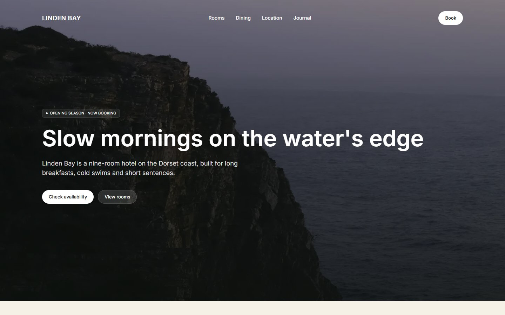
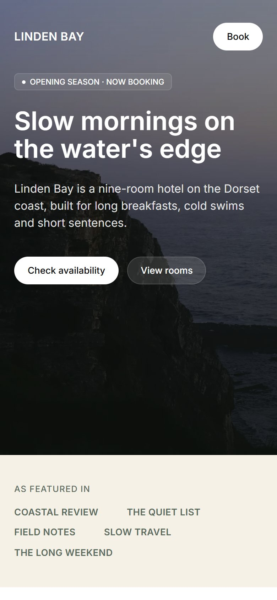

# Linden Bay

A Figma design of a boutique hotel landing page, built as a fast and accessible website.

**Live site:** https://idento.github.io/linden-bay/

| Desktop | Mobile |
| --- | --- |
|  |  |

## The design

The Figma file has three frames of the same page: desktop (1440 px), tablet (834 px) and mobile (390 px). The site reproduces all three and adapts smoothly between them.

Fidelity was checked by capturing the site at 1440, 834 and 390 px and comparing it with the PNG exports of each frame: every section boundary lands within 8 px of the design over pages 5,700 to 7,100 px tall, most of them within 2 to 6 px. Desktop and mobile spacing, font sizes and colors come from the Figma file itself; tablet values were measured on its PNG export.

Small fixes where the design breaks:
- tablet footer: the copyright line and the social links touch each other ("Mërović.Instagram"), they are now spaced;
- mobile call to action: the title runs to the screen edges, it now keeps the page margins;
- the orange used for small labels and prices (`#b07a3e`, 3.27:1 on the cream background) is darkened to `#926533` (4.52:1) so the text meets WCAG AA. The original orange stays on dark backgrounds;
- the menu links over the hero photo are pure white instead of 90% white, which fell to about 4.3:1 on the light part of the sky at tablet width.

## What was done

**Accessibility**
- Text contrast meets WCAG AA (see above).
- Real headings in order, lists, description lists for the key numbers, the distances and the FAQ.
- The "Y / ~ / N" badges of the amenities are read as "Included", "Partly" and "Not available" by screen readers.
- Skip link, visible focus, every action reachable with the keyboard.
- Decorative photos are hidden from screen readers, content photos have a description.

**Performance**
- Static HTML, CSS inlined in the page, 431 bytes of JavaScript (newsletter form check).
- Images converted to WebP at build time in several sizes. The hero image is prioritized, the others load when the visitor scrolls to them.
- Inter variable font hosted with the site.
- Lighthouse 13.5 on the live site (October 21, 2026, median of 3 runs): 100 performance, 100 accessibility, 100 best practices, 100 SEO, on both mobile and desktop. Largest Contentful Paint 1.1 s on simulated mobile, 0.4 s on desktop. Cumulative Layout Shift 0.025 on mobile, 0.003 on desktop.

## Stack

- [Astro](https://astro.build) 7, static output, strict TypeScript
- HTML, CSS (custom properties, Flexbox, Grid), vanilla TypeScript
- `astro:assets` for image optimization
- Inter from [Fontsource](https://fontsource.org)
- GitHub Pages, deployed with GitHub Actions

## Run locally

```sh
npm install
npm run dev
```

`npm run check` runs the type checks and a production build.

## Credits

- Design: [Linden Bay · Boutique Hotel Landing Page](https://www.figma.com/community/file/1690005449721707193/linden-bay-boutique-hotel-landing-page) by Alex Mërović, licensed under [CC BY 4.0](https://creativecommons.org/licenses/by/4.0/). Changes: the fixes listed above.
- Photos and portraits: included in the design file. The Figma page does not say where they come from.
- Linden Bay is a fictional hotel. Booking buttons open an email to a placeholder address, the newsletter form sends nothing.
- Code: Maxime Tsouri.
